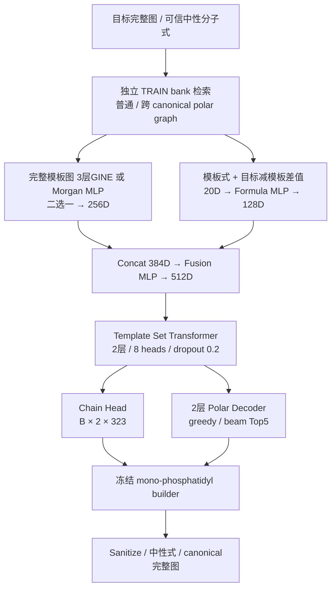

# Phospholipid structure pretraining

**当前研究目标（2026-10-22）：** 模板结构与分子式条件下的磷脂头基生成，结构条件训练本身作为第一版最终训练。
沿用当前模型参数，正式训练模板池以5,000为主，保留500/2,000/5,000/10,000/20,000的规模实验及评价；
此前200–350模板为人工种子与小池诊断。后续实际模板来自MS-DIAL、LipidGate等有谱图、结构明确的来源，
提供已知候选库受限排序与Free生成两种应用方式，不要求谱图监督微调。
见[当前执行定义](docs/experiments/TEMPLATE_GUIDED_PHOSPHOLIPID_GENERATION_V1.md)和
[设计记录](configs/template_guided_generation_v1_plan.json)。这些新实验尚未执行；下方结果是历史实验。

**已报道及数据库来源 Polar 参考库 v0.1：** 已收集182个不同位点化图，
24个已核实头基文献、158个保留为数据库/规则来源未核实；63个通过现有Builder，30个存在于冻结库。
提供名称/别名及ID双向查询、Excel同名多结构切换、来源映射和追加导入工具。
完整结构与工作簿只留G盘；无训练或谱图生成。见[方法](docs/experiments/REPORTED_HEADGROUPS_V01.md)
和[聚合报告](docs/results/REPORTED_HEADGROUPS_V01_SUMMARY.md)。

**结构相似度与模板收益评价：** 三个FP模型、Beam20/50、固定512诊断目标已完成；未重新训练。
50k/5,000 Beam50的Top1/5/10平均Polar Tanimoto为0.2736/0.3347/0.3499，
最佳输入模板均值0.5470；Top10在146/512（28.52%）目标上获得正收益，但平均Delta为−0.1971。
低模板组平均收益接近0，尚不支持“稳定超过参考模板”的结论。优先检验模板利用和真实MS/MS条件，暂不盲目扩池。
见[新评价报告](docs/results/POLAR_PRETRAIN_SIMILARITY_EVAL_V04_RESULTS.md)、
[公开统计图](docs/results/POLAR_PRETRAIN_SIMILARITY_EVAL_V04_FIGURES/)、
[磁盘整理审计](docs/results/EXPERIMENT_STORAGE_AUDIT.md)。具体结构案例仅留G盘，未上传。

**50k/5,000-step 已完成（RTX4070 SUPER）：** 368项测试、真实CUDA反向与恢复、12个受监控作业通过。
固定512诊断头基的最终Beam50严格式覆盖77.54%，Polar Top5/Top10为7.42%/9.18%
（旧20k/3,000为73.83%、3.52%/4.30%）。未观察到新增GPU故障；WATCHDOG权限限制见报告。
同步数3,000的改善不一致，5,000步结果同时改变池和步数；保留全部权重，暂不扩至全库或开展MS/MS训练。

**v0.4-FP 稳定训练入口：** [50k 分阶段实验](docs/experiments/POLAR_FP_BASE_50K.md)
固定 Morgan r2/2048 → MLP 256D、Polar 式/差值 20D →128D、融合512D、
2层/8头 Set Transformer＋TCLS、2层/8头 Polar Decoder（FFN2048、长度84），共16,468,671参数。
随机初始化、TRAIN-only 50k不同头基、K3/H80%/HC20%、AdamW1e-4、有效batch16，
原生RTX4070 SUPER使用Math/FP32并关闭TF32；按1,000/3,000/最多5,000步决策。
入口为 `train_polar_fp50k.py` 和 `scripts/supervise_polar_fp50k.py`，先通过独立CPU及CUDA反向/恢复门槛。
历史模型与冻结数据保留；实际完成阶段和指标见[结果](docs/results/POLAR_FP_BASE_50K_RESULTS.md)
及[聚合JSON](docs/results/POLAR_FP_BASE_50K_RESULTS.json)。仍为给定链/式的structure-oracle诊断，未开展MS/MS微调。

**RTX 4070 接续：** 使用另一台电脑的原生 Windows 与现有默认 CUDA 环境。精简迁移包已生成并逐文件校验：ZIP 约 1.11 GB，展开约 2.71 GB，775 个文件，只保留 v0.4 必需数据、两份 3,000 步权重、固定样本及最新项目资料。见[交接清单](docs/HANDOFF_RTX4070_WINDOWS.md)与[迁移回执/校验码](docs/results/RTX4070_TRANSFER_RECEIPT.json)。旧测试输出与中间 checkpoints 不打包；NVIDIA 原生 Windows 入口尚待在目标机器验证，本机 GPU 工作已停止。

**2026-10-20 分子式约束推断：** 复用 v0.4 的 Morgan/GINE 3,000 步权重，未重新训练。358 项 CPU 测试通过；固定 512 头基的 Beam 5 四方法对照完整。元素计数＋基础语法将严格分子式覆盖率由 11.72%/9.38% 提高到 38.09%/30.27%，但 Polar Top-5 exact 仍仅 8/512、5/512。**10:44 出现新的 LiveKernelEvent 141 与用户确认的黑屏，已停止全部 GPU 作业并保留停止锁；Beam 20/50 正式比较未完成，不能宣称 Math/FP32 已解决黑屏。** 见[实验方法与复现](docs/experiments/POLAR_FORMULA_BEAM_V04.md)、[结果与故障结论](docs/results/POLAR_FORMULA_BEAM_V04_RESULTS.md)、[聚合 JSON](docs/results/POLAR_FORMULA_BEAM_V04_RESULTS.json)。旧代码、冻结数据、报告与 54 个 checkpoints 的保护哈希均通过。

**最新 v0.4 Polar-only：** 独立实现已知链条件下的 Polar 生成：无链 glycerol–Polar 图、重新计算的 Morgan/GINE 特征、20D Polar 分子式条件、80% 同链异头基 H＋20% 异链异头基 HC。保留 TCLS＋全部模板 memory，不再预测链。见 [v0.4 方法与复现](docs/experiments/POLAR_ONLY_V04.md)、[实测结果与限制](docs/results/POLAR_ONLY_V04_RESULTS.md)、[聚合指标与哈希](docs/results/POLAR_ONLY_V04_RESULTS.json)，配置为 [FP](configs/polar_only_v04_fp.yaml) / [GINE](configs/polar_only_v04_gine.yaml)。下方 v0.3 记录与所有旧数据、报告和 checkpoints 保留。当前仍为离线 structure-oracle 预训练，不是 MS/MS 鉴定结果。

**本机 v0.4 实测：** 311项测试、全库公式/检索审计通过；FP/GINE均通过32头基过拟合和真实checkpoint续训，分别完成20k目标池的3,000步Math/FP32训练，无新增GPU故障。最终512验证头基的greedy exact均0，beam Top5为3/512与1/512；暂缓全量预训练，未执行5,000步、50k池或MS/MS微调。v0.4使用给定链，不能与v0.3预测链的完整分子指标直接混比。

## v0.3 双输出实验记录

**2026-10-19 中程结果：** Morgan MLP / GINE 均已从原 1,001 步检查点恢复并完成累计 5,000 步，使用同一 20k 训练池与固定 128+512 条验证样本。Math/FP32 下本轮未新增 GPU 转储；286 项测试通过。512 条诊断合法 Polar 为 43.95% / 48.44%，原始完整结构 exact 均为 0；Morgan 可选公式筛选后命中 2/512。建议先完成有界扩展与公式/链约束对照，再决定全量；未执行全库预训练或 MS/MS 微调。见 [完整中程结果](docs/experiments/MIDTERM_STRUCTURE_RESULTS_20261019.md)、[方法](docs/experiments/MIDTERM_STRUCTURE_20261019.md) 与 [聚合 JSON](docs/results/MIDTERM_STRUCTURE_20261019.json)。

**2026-10-19 WSL 本机更新：** RX9070XT 使用显式 `--attention-backend math` 路径，FP/GINE 均通过 32 条真实结构过拟合及 20k 目标池 / 1000-step GPU smoke，并各实际恢复至 1001 步，无新增 Windows GPU 超时。默认 attention 路径曾触发黑屏；完整记录、修正和生成质量限制见 [本机 GPU 验证](docs/ROCM_VALIDATION_2026-10-19.md)。下文原 CPU smoke 数字继续作为历史结果保留，未执行完整多轮预训练或 MS/MS 微调。

使用冻结的 2,015,000 条完整磷脂结构：输入完整结构模板和可信中性分子式，输出两个 canonical chain 槽位和含 P 极性片段。实际结果见 [本轮报告](docs/PRETRAINING_V03_RESULTS.md)，方法见 [执行说明](docs/PRETRAINING_V03.md)。

这是 **structure-oracle template retrieval**：离线检索使用已知目标完整图的 Morgan 指纹。因此本阶段指标不能称为 MS/MS 鉴定准确率。没有 MS/MS、原子掩码或其他辅助任务。



GINE 保留内部宽度128、sum pooling、原有7/3化学特征；没有 GPSConv、图内MHSA或RWSE。输入不拆链/头基。两个输出链槽位采用 builder 排序，**不代表 sn 位置**；lyso 为链+NULL。双键位置沿用冻结 MS-DIAL 代表结构。词表 A177/O84/P61+NULL=323，P/A 仅保留原有3条 exact PE 配对。

Polar 边界为 `glycerol-O | P-containing polar fragment`，如 `[*:1]P(=O)(O)OCC#N`，attachment 在图上校验。全部195,306个标签审计后，decoder最大长度为 **84（含BOS/EOS）**，词表63，零OOV、零截断。正式模型只有链和 polar 两分支，没有骨架分类、结构相似度或分子式可用性输入。中性式必填，元素顺序 `C H N O P S F Cl Br I`，差值为 target-template。

## 安装与回归

推荐 Python3.12；本机 CPU 使用 Python3.13 / Torch2.9.1+cpu / PyG2.8.0.post1。先安装适合设备的 Torch，再安装项目。ROCm 环境按 [WSL指南](docs/WSL_ROCm.md) 保留 AMD Torch。

```bash
python -m pip install -r requirements-extraction.txt -e '.[dev,library,retrieval]'
python -m pytest -q
python scripts/check_encoder_batch.py
python scripts/count_parameters.py
```

`train_structure_dummy.py` 保留用于CI；toy结构和人为标签只核验程序，不代表真实训练效果。

## 真实数据准备

私有数据不在GitHub。迁移冻结原库和索引时保留哈希。以下只生成新派生文件：

```bash
python -m structure_pretrain.data.prepare_v03
python scripts/audit_pretraining_head_difficulty.py
python -m structure_pretrain.retrieval.train_only --threads 2
```

默认输入 `data/structure_library_v0.3/` 和 `data/private/morgan_index_v0.3/`，输出 `data/private/pretraining_v03/`；CLI可指定已校验的SSD工作目录。HNSW只装载train结构的FP groups，不能先全库Top10后过滤。Morgan radius2/2048/chirality=false，阈值.4、K≤10。分数仅在检索缓存与报告中保存。

完整结构按train/validation/test为1,813,451 /100,792 /100,757；头基组175,772 /9,767 /9,767。三组的polar ID和规范图交集均为零。Test只作要求的标签/覆盖审计，不参与smoke训练或模型选择。

## 历史 CPU smoke：显式小训练

最初 CPU 真实数据接入运行：FP/GINE各累计11步（10步+实际恢复1步）。
全库标签/划分/合法检索与671条标签重建审计通过；16目标自由生成均未产生EOS，合法率为0。
详细指标、参数数量和十二项验收回答见[真实接入结果](docs/PRETRAINING_V03_RESULTS.md)。
该结果保留为 CPU 接入历史；后续 ROCm 验证和中程生成质量见页首链接。

```bash
python train_structure_real.py --config configs/pretraining_v03_local_fp.yaml --output outputs/pretraining_v03/local_smoke/fingerprint
python train_structure_real.py --config configs/pretraining_v03_local_gine.yaml --output outputs/pretraining_v03/local_smoke/graph
python train_structure_real.py --config configs/pretraining_v03_local_fp.yaml --steps 11 --resume outputs/pretraining_v03/local_smoke/fingerprint/checkpoint/last.pt --output outputs/pretraining_v03/local_smoke/fingerprint
```

默认真实512 train /128 validation、10 optimizer steps、CPU batch2。自由生成独立评估固定16个validation目标，报告EOS、耗尽长度和原始无效结果；不强制EOS、不修复或后验筛式。标签不截断。CPU smoke最多50 steps，`--steps`为累计optimizer steps。

磁盘Dataset只缓存有限Arrow shards和模板特征，仅真实模板组成PyG Batch。公式标准化流式使用合法train pairs。checkpoint绑定数据、词表、split、检索和统计哈希，恢复优化器、RNG和消费样本游标；旧权重不兼容。

9070 XT的环境检查、20k/2k/1000-step GPU smoke及独立full命令见[WSL指南](docs/WSL_ROCm.md)。本机已完成显式 Math 路径的 GPU 验证与中程实验；尚未执行完整多轮预训练或 MS/MS 微调。

## RTX 4070 SUPER 原生 Windows 接续

本机项目、冻结数据、检查点、运行输出和缓存位于 `G:\yzx\linzhiyuce`。
独立 CUDA 环境、CPU gate、GPU 监督器和有界/完整 512 目标实验命令见
[NVIDIA 接续指南](docs/experiments/POLAR_FORMULA_BEAM_CUDA_V04.md)。
[本机聚合结果](docs/results/POLAR_FORMULA_BEAM_CUDA_V04_RESULTS.md) 与旧 AMD 报告分开保存。

## 文件

- `data/prepare_v03.py`：全库标签/token、组划分、671条重建审计。
- `retrieval/train_only.py`：独立train bank、两模式缓存、覆盖率、公式统计。
- `data/real_structure_dataset.py`：lazy读取、有界缓存、可复现抽样。
- `models/`：GINE/FP、独立公式融合、集合Transformer、链和polar两分支。
- `training/generation_metrics.py`：自由生成、冻结builder组装与化学指标。
- `train_structure_real.py`：真实训练、周期checkpoint、续训和资源报告。
- `configs/pretraining_v03_*.yaml`：local/ROCm smoke/显式full。
- [数据契约](docs/DATA_SCHEMA.md)、[v0.3扩库来源](docs/INCREMENT_V03_RESULTS.md)。

历史v0.1 dummy报告和v0.2/v0.3建库报告继续保留；旧四槽/骨架分类和全库reference结果不描述当前模型，不能当作合法训练缓存。私有结构、逐样本预测、索引和checkpoint不上传GitHub。
