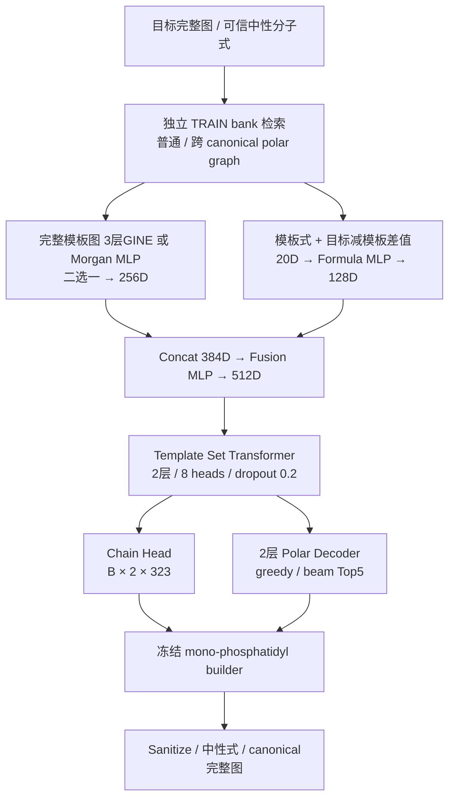

# Phospholipid structure pretraining v0.3

**2026-10-19 WSL 本机更新：** RX9070XT 使用显式 `--attention-backend math` 路径，FP/GINE 均通过 32 条真实结构过拟合及 20k 目标池 / 1000-step GPU smoke，并各实际恢复至 1001 步，无新增 Windows GPU 超时。默认 attention 路径曾触发黑屏；完整记录、修正和生成质量限制见 [本机 GPU 验证](docs/ROCM_VALIDATION_2026-10-19.md)。下文原 CPU smoke 数字继续作为历史结果保留，未执行完整多轮预训练或 MS/MS 微调。

使用冻结的 2,015,000 条完整磷脂结构：输入完整结构模板和可信中性分子式，输出两个 canonical chain 槽位和含 P 极性片段。实际结果见 [本轮报告](docs/PRETRAINING_V03_RESULTS.md)，方法见 [执行说明](docs/PRETRAINING_V03.md)。

这是 **structure-oracle template retrieval**：离线检索使用已知目标完整图的 Morgan 指纹。因此本阶段指标不能称为 MS/MS 鉴定准确率。没有 MS/MS、原子掩码或其他辅助任务。



GINE 保留内部宽度128、sum pooling、原有7/3化学特征；没有 GPSConv、图内MHSA或RWSE。输入不拆链/头基。两个输出链槽位采用 builder 排序，**不代表 sn 位置**；lyso 为链+NULL。双键位置沿用冻结 MS-DIAL 代表结构。词表 A177/O84/P61+NULL=323，P/A 仅保留原有3条 exact PE 配对。

Polar 边界为 `glycerol-O | P-containing polar fragment`，如 `[*:1]P(=O)(O)OCC#N`，attachment 在图上校验。全部195,306个标签审计后，decoder最大长度为 **84（含BOS/EOS）**，词表63，零OOV、零截断。正式模型只有链和 polar 两分支，没有骨架分类、结构相似度或分子式可用性输入。中性式必填，元素顺序 `C H N O P S F Cl Br I`，差值为 target-template。

## 安装与回归

推荐 Python3.12；本机 CPU 使用 Python3.13 / Torch2.9.1+cpu / PyG2.8.0.post1。先安装适合设备的 Torch，再安装项目。ROCm 环境按 [WSL指南](docs/WSL_ROCm.md) 保留 AMD Torch。

```bash
python -m pip install -r requirements-extraction.txt -e '.[dev,library,retrieval]'
python -m pytest -q
python scripts/check_encoder_batch.py
python scripts/count_parameters.py
```

`train_structure_dummy.py` 保留用于CI；toy结构和人为标签只核验程序，不代表真实训练效果。

## 真实数据准备

私有数据不在GitHub。迁移冻结原库和索引时保留哈希。以下只生成新派生文件：

```bash
python -m structure_pretrain.data.prepare_v03
python scripts/audit_pretraining_head_difficulty.py
python -m structure_pretrain.retrieval.train_only --threads 2
```

默认输入 `data/structure_library_v0.3/` 和 `data/private/morgan_index_v0.3/`，输出 `data/private/pretraining_v03/`；CLI可指定已校验的SSD工作目录。HNSW只装载train结构的FP groups，不能先全库Top10后过滤。Morgan radius2/2048/chirality=false，阈值.4、K≤10。分数仅在检索缓存与报告中保存。

完整结构按train/validation/test为1,813,451 /100,792 /100,757；头基组175,772 /9,767 /9,767。三组的polar ID和规范图交集均为零。Test只作要求的标签/覆盖审计，不参与smoke训练或模型选择。

## 当前电脑：显式小训练

本轮真实数据运行已完成：FP/GINE各累计11步（10步+实际恢复1步）。
全库标签/划分/合法检索与671条标签重建审计通过；16目标自由生成均未产生EOS，合法率为0。
详细指标、参数数量和十二项验收回答见[真实接入结果](docs/PRETRAINING_V03_RESULTS.md)。
该结果用于核验管线，GPU生成质量仍待另一台设备验证。

```bash
python train_structure_real.py --config configs/pretraining_v03_local_fp.yaml --output outputs/pretraining_v03/local_smoke/fingerprint
python train_structure_real.py --config configs/pretraining_v03_local_gine.yaml --output outputs/pretraining_v03/local_smoke/graph
python train_structure_real.py --config configs/pretraining_v03_local_fp.yaml --steps 11 --resume outputs/pretraining_v03/local_smoke/fingerprint/checkpoint/last.pt --output outputs/pretraining_v03/local_smoke/fingerprint
```

默认真实512 train /128 validation、10 optimizer steps、CPU batch2。自由生成独立评估固定16个validation目标，报告EOS、耗尽长度和原始无效结果；不强制EOS、不修复或后验筛式。标签不截断。CPU smoke最多50 steps，`--steps`为累计optimizer steps。

磁盘Dataset只缓存有限Arrow shards和模板特征，仅真实模板组成PyG Batch。公式标准化流式使用合法train pairs。checkpoint绑定数据、词表、split、检索和统计哈希，恢复优化器、RNG和消费样本游标；旧权重不兼容。

9070 XT的环境检查、20k/2k/1000-step GPU smoke及独立full命令见[WSL指南](docs/WSL_ROCm.md)。本机没有执行GPU验证或完整多轮预训练。

## 文件

- `data/prepare_v03.py`：全库标签/token、组划分、671条重建审计。
- `retrieval/train_only.py`：独立train bank、两模式缓存、覆盖率、公式统计。
- `data/real_structure_dataset.py`：lazy读取、有界缓存、可复现抽样。
- `models/`：GINE/FP、独立公式融合、集合Transformer、链和polar两分支。
- `training/generation_metrics.py`：自由生成、冻结builder组装与化学指标。
- `train_structure_real.py`：真实训练、周期checkpoint、续训和资源报告。
- `configs/pretraining_v03_*.yaml`：local/ROCm smoke/显式full。
- [数据契约](docs/DATA_SCHEMA.md)、[v0.3扩库来源](docs/INCREMENT_V03_RESULTS.md)。

历史v0.1 dummy报告和v0.2/v0.3建库报告继续保留；旧四槽/骨架分类和全库reference结果不描述当前模型，不能当作合法训练缓存。私有结构、逐样本预测、索引和checkpoint不上传GitHub。
