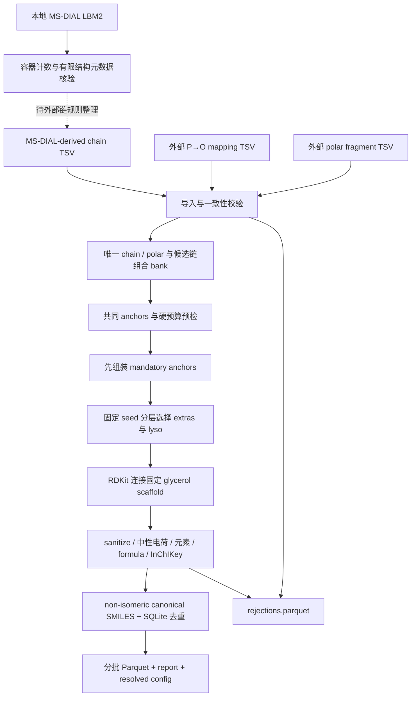

# 结构库构建 v0.1

本阶段只运行独立的 structure library builder；没有训练模型，没有修改现有 GINE/Morgan、retrieval、Transformer、decoder、loss、metrics 或训练脚本。

当前已找到本地 MS-DIAL 原始库，位置和核验结果见 [MSDIAL_LOCAL_SOURCES.md](MSDIAL_LOCAL_SOURCES.md)。原始 `.lbm2` 包含库记录与谱图数据，并不直接等于符合本接口的链片段表。此次只核验容器和有限结构元数据，未自动制定真实链切割、P→O 映射或 PubChem 搜索规则。

已执行的示例构建得到 **60 条合成示例结构**，不是 MS-DIAL-derived 真实训练库：11 条示例 chain rules、4 个示例 polar fragments、66 个候选链组合；最终 41 A/A、11 O/A、2 PE-P/A、6 lyso。每个 polar 有 15 条结构，7 个共同 AA anchor 每个均覆盖 4 个 polar，mandatory 共 28 条。双键位置来自示例输入表的明确片段，示例不能作为真实 MS-DIAL 双键规则使用。

## 安装与运行

已经安装项目的环境可执行 `python -m pip install -e '.[library]'`。独立建库环境可以完全不安装 PyTorch：

```bash
python -m venv .venv
source .venv/bin/activate
python -m pip install -r requirements-library.txt
python -m pip install --no-deps -e .
```

Windows 使用 `.venv\Scripts\Activate.ps1`。builder 本身只依赖 RDKit、PyArrow、PyYAML；原始库元数据核验另使用 msgpack，不依赖显卡、ROCm 或任何网络模型。

从项目根目录执行 demo：

```bash
python scripts/build_structure_library.py \
  --config examples/library_builder/demo_build.yaml \
  --chains examples/library_builder/chains.tsv \
  --polar examples/library_builder/polar_moieties.tsv \
  --p-to-o-mapping examples/library_builder/p_to_o_mapping.tsv \
  --output data/structure_library_v0.1_demo
```

本地最终复核产物位于 `data/structure_library_v0.1_demo_final/`。输入和完整报告样例已提交在 `examples/library_builder/`，生成的 Parquet、SQLite 和本地库元数据不上传仓库。输出目录非空时 CLI 拒绝覆盖；重复构建请指定新的目录。

真实输入接入命令：

```bash
python scripts/build_structure_library.py \
  --config configs/library_build.yaml \
  --chains path/to/msdial_derived_chains.tsv \
  --polar path/to/polar_moieties.tsv \
  --p-to-o-mapping path/to/p_to_o_mapping.tsv \
  --output data/structure_library_v0.1
```

P→O 表可以暂不提供；未启用 PE-P 且没有外部映射的 P token 会被跳过并记录，不影响已经独立提供的 O 规则。真实默认预算上限为 1,500,000，每个 polar 最多 100 条 extras；示例预算仅为 100、每 head 8 条 extras。

## 数据流



没有对全部 heads × 全部 combinations 做结构组装。全局 chain bank 只创建一次，strata 只排序一次；每个 head 使用 SHA256 固定的起点轮转，按 AA、OA、PE-PA 家族及碳数/不饱和度层轮流选取。canonical 去重由磁盘 SQLite 处理，Parquet 分批写入；v0.1 的 chain bank、polar table 和 rejection logs 仍在内存中，真实数据规模确定后再评估是否需要进一步流式化。当前没有进行 150 万条规模的性能压测。

## 新增目录与职责

```text
phospholipid-structure-pretrain/
├── requirements-library.txt
├── configs/library_build.yaml
├── .github/workflows/library_builder.yml
├── scripts/
│   ├── build_structure_library.py       # 配置/输入/输出 CLI；不训练
│   └── inspect_msdial_library.py        # 本地 LBM2 容器与元数据核验
├── src/structure_pretrain/library_builder/
│   ├── __init__.py
│   ├── schemas.py                      # 独立数据类、配置、硬上限
│   ├── chain_library.py                # 外部链导入、片段一致性、外部 P→O 映射
│   ├── chain_combinations.py           # 无序 AA、固定 OA、PE-PA、单链 bank
│   ├── polar_library.py                # 外部 polar 导入、边界/权限校验、源去重
│   ├── assembly.py                     # 固定 glycerol 与片段连接
│   ├── canonicalize.py                 # 价态、元素、中性 formula、SMILES、InChIKey
│   ├── validation.py                   # 唯一 attachment point 与片段角色校验
│   ├── budget.py                       # mandatory 超限阻断及均匀 extras 配额
│   ├── sampling.py                     # 可复现分层采样、anchor singles 优先
│   ├── deduplicate.py                  # SQLite canonical 去重、provenance 合并
│   ├── parquet_io.py                   # 明确 Arrow schema、分批输出
│   ├── pipeline.py                     # 运行流程、输入 hashes、失败/完成报告
│   ├── report.py                       # 必需统计、分布、top-20、lyso 实际比例
│   └── msdial_inventory.py             # 有界 LZ4 前缀、MessagePack 元数据读取
├── examples/library_builder/
│   ├── README.md
│   ├── chains.tsv
│   ├── polar_moieties.tsv
│   ├── p_to_o_mapping.tsv
│   ├── demo_build.yaml
│   └── library_report.example.json
├── tests/library_builder/
│   ├── __init__.py
│   ├── conftest.py
│   ├── test_library_chain_sort.py
│   ├── test_library_oa_assignment.py
│   ├── test_library_pe_p_rule.py
│   ├── test_library_anchor_combos.py
│   ├── test_library_budget.py
│   ├── test_library_assembly.py
│   ├── test_library_formula.py
│   ├── test_library_dedup.py
│   ├── test_library_report.py
│   ├── test_library_sampling.py
│   └── test_library_msdial_inventory.py
└── docs/
    ├── LIBRARY_BUILDER.md
    ├── MSDIAL_LOCAL_SOURCES.md
    └── library_builder_verification.json
```

另外修改 `.gitignore` 排除生成库；`pyproject.toml` 只新增 library optional dependencies；旧模型 CI 加路径条件，builder-only 更改只触发新建库 CI，不启动模型训练。README 加入建库入口。

## 输入契约：chain table

必需 TSV 列：`chain_token`、`linkage_type`、`carbon_count`、`double_bond_count`、`representative_fragment_smiles`、`representative_double_bond_positions`、`source`。

- `A` 片段例如 `[*:1]C(=O)...`，carbon_count 包含 carbonyl carbon；scaffold 提供酯氧。
- `O` 片段例如 `[*:1]CCC...`，scaffold 提供醚氧。
- `P` 片段例如 `[*:1]C=CC...`，必须有 attachment-adjacent vinyl bond。
- attachment dummy 固定 `[*:1]`，必须唯一、单键、degree=1。当前支持外部提供的未修饰线性 A/O/P 链，氧化/支链等规则不自动扩张。
- DB positions 使用整数 JSON list，从 attachment-adjacent carbon 记为 C1；包括实际存在的全部 C=C 位置。程序只核对现有 SMILES，不生成或补猜位置。
- P 另需 `p_db_count_includes_vinyl=true/false`，由外部规则声明；一个表内不能混用。demo 的 P-16:0 采用 false，positions=[1]。这是读取明确的注释约定，不是用 DB+1 生成 P→O 映射。
- 一个 token 只能对应一个 non-isomeric 代表片段；冲突的同 token 规则全部排除并记录，不任意挑一个位置。

外部 `p_to_o_mapping.tsv` 必需列 `p_token`、`o_token`，可另存 `source`。两端都必须存在于已校验的链库，类型必须 P→O、碳数相同、片段 C/H 组成相同。程序不会创建不存在的 O token。映射的来源由输入表 hash 和 `mapped_from_p_tokens` 追踪。

## 输入契约：polar table

必需列：`polar_id`、`source`、`source_id`、`original_smiles`、`polar_fragment_smiles`、`attachment_atom_map`、`polar_family`；权限列 `allow_aa/allow_oa/allow_pa` 默认 true/true/false。

- polar 必须是已经由外部规则切好、可解析且带一个唯一 attachment point 的片段。
- 本接口的连接边界为 `glycerol-O | P-polar`，因此 polar dummy 的邻居必须是 P；不能同时把连接氧放在 scaffold 和 polar 两侧。
- 允许 P–O–C 和 P–C，demo 包含 phosphonate；不限定为传统六种磷脂头基，不执行 PubChem SMARTS 搜索。
- `PE`、`known_other`、`pubchem_expanded`、`phosphonate`、`other` 为支持的外部 family 声明。只有外部指定 PE、allow_pa=true 且 enable_pe_p=true 才能生成 P/A。
- import 不是自动切割器；没有 attachment 的完整 lipid 会被拒绝，已有 acyl-glycerophospholipid 子结构的 polar 也会被拒绝。未知的完整 ether-lipid 边界不能仅靠这个 guard 自动识别，外部 polar 表仍需审核。
- 等价 polar fragment 合并 source IDs/provenance；若 family 或权限冲突，全部排除，不擅自选择更宽的权限。

polar fragment 包含 P，属于本次组装接口的边界；尚未自动转换为现有模型的 headgroup labels。后续训练数据的标签边界仍需由真实数据方案确定。

## 位置、预算与化学规则

- AA 使用按碳数/DB 数排序的无序组合，顺序交换不会再生成另一种 sn 图。
- OA 的 O、PE-PA 的 P 固定放 terminal sn1-like 代表位点，A 放中央位点；lyso 默认放同一 terminal 位点。
- **representative assignment != biological sn assignment**。所有 structure rows 均记录 `representative_sn_assignment=true`。
- AA anchors 仅在 token 均存在且 head 允许 AA 时启用。allow_aa=false 的 head 不强行生成被禁止的 AA，写入 `anchor_not_permitted`。
- mandatory 超预算时停止并写失败报告、可允许的最大 eligible polar head 数，不静默丢弃 anchor。
- `max_extra_per_head` 包含 di-chain extras 和 lyso extras。剩余配额均匀分配，未用额度可在该上限内二次分配。
- lyso 约 10% 是目标，不是硬保证；anchor di-chain 优先，单链 anchor 优先于其他单链。候选不足或预算太小时报告实际比例。
- bis/3/4-chain 接口开关保留，但启用时明确 NotImplementedError，不枚举 cardiolipin、不伪装已支持。
- 完整分子 sanitize、总电荷 0、限定十种元素后计算 neutral formula。PC 内部 N+/O− 保留。未自动中和离子、删除 counterion 或猜 precursor formula。
- 去除手性及 E/Z，不改变 C=C 的连接位置；canonical SMILES 去重并保存 InChIKey。超出本元素/闭壳层表示的输入如 Si、同位素标注、自由基等拒绝并记录。

## 输出与报告示例

输出文件：`chain_library.parquet`、`chain_combinations.parquet`、`polar_library.parquet`、`structures.parquet`、`rejections.parquet`、`library_report.json`、`build_config_resolved.yaml`，以及磁盘去重数据库 `dedup.sqlite`。

structures 包含计划要求的全部字段：stable SHA256 `structure_id`、architecture、polar ID/family、chain tokens/linkage、两种 SMILES 字段、完整 neutral formula 及十元素整数计数、InChIKey、anchor/lyso/sn 标记、chain rule/polar 来源。额外保存组合 ID、映射来源和链注释汇总。`architecture` 当前为字符串 `mono_phosphatidyl`。

报告中的 `total_carbon_distribution` / `total_double_bond_distribution` 是**链注释之和**，不包含 glycerol/polar 的碳；P 的计数依据输入约定。完整分子组成另存于每行 neutral_formula_*。

```json
{
  "status": "complete",
  "data_kind": "demo_fixture_not_real_training_library",
  "total_structures": 60,
  "unique_canonical_smiles": 60,
  "number_of_chains": 11,
  "number_of_chain_combinations": 66,
  "number_of_polar_moieties": 4,
  "mandatory_anchor_count": 28,
  "AA_count": 41,
  "OA_count": 11,
  "PE_PA_count": 2,
  "lyso_count": 6,
  "bis_phosphatidyl_count": 0,
  "rejected_count": 0,
  "neutral_formula_missing_count": 0,
  "training_performed": false
}
```

完整示例见 [library_report.example.json](../examples/library_builder/library_report.example.json)，包含全部分布、anchor counts、每 head counts 和两组 top-20。

## 验证及真实输入 TODO

建库 pytest 共 **46 项通过**，涵盖 AA 顺序去重、OA 位点、PE-P 权限、外部 P→O、缺失映射日志、P 注释口径冲突、anchor 完整性、超限失败报告、多种预算边界、lyso、phosphate/phosphonate 组装、正确完整中性公式、价态/电荷/元素拒绝、立体信息去除与位置连接保留、provenance 合并、同 seed 完全一致的结构 rows、分层覆盖、有界 LBM2 元数据读取。

```bash
python -m pip install pytest ruff
python -m pytest -q --confcutdir=tests/library_builder tests/library_builder
```

该命令隔离原来的模型测试 conftest，不会导入 Torch 或运行 GINE/Morgan optimizer。既有模型测试没有在本阶段重新执行，因为本阶段限定为建库。未启动任何训练，也未做 MS/MS 分析。

仍需你提供或单独确定：

1. 从找到的 MS-DIAL 源得到的真实 chain fragment table，带规则来源和明确 DB positions。
2. 真实 P→O mapping table，不能用 demo 映射代替。
3. PubChem-expanded polar fragment table，以及其构建/切割边界规则。
4. 真实 PE-P 识别规则和 P DB 注释口径。builder 只接受显式声明，不从名字或 DB 数猜测。

此次完成的是可复现的建库流水线和 demo；未声称已经构建 150 万条真实训练结构。
