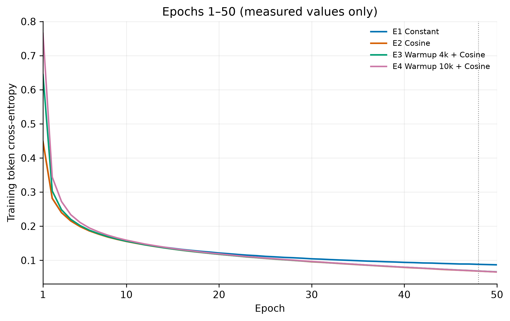
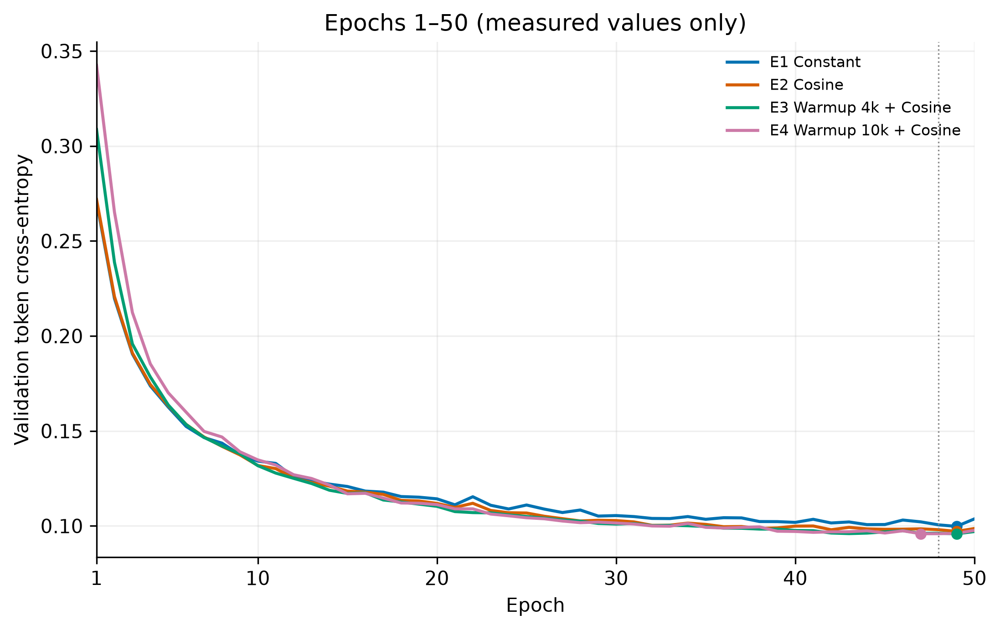
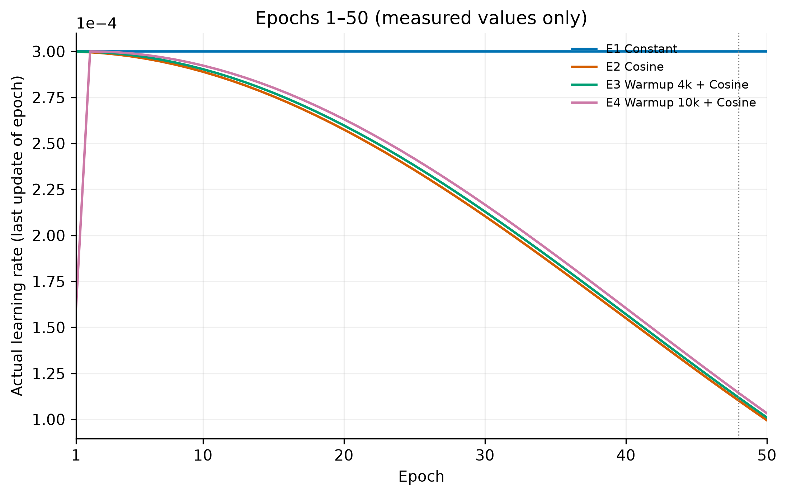

# Whole glycerol-core learning-rate schedule comparison

Status: **completed**; stage: `four_schedules_and_validation_Beam32_complete`.

Shared TRAIN170,872 / validation9,493 / bank8,000; frozen test9,499 is unused. Same model (16,479,940 parameters), seed42, Batch32, AdamW, FP32/Math/TF32off.

Minimum50 complete epochs for measured common plots; then patience5, maximum80. Patience accumulates throughout and is not reset at50. Best weight is the global minimum full-validation token CE, which may occur before or after50. All cosine cycles remain80 epochs (427,200 updates), minimum LR1e-5.

E3 original48-epoch run and epoch43 best remain immutable. Independent continuation restores epoch48 model, AdamW moments, scheduler and RNG, without a new warmup. E3 figures join its original1–48 and measured49+; the dotted line marks48. Original best is retained unless continuation improves validation CE. E1/E2/E4 load one identical initial tensor/RNG snapshot; old E3 has recorded seed/source recipe evidence, but no saved initial tensor snapshot, so direct initial-tensor equality with historical E3 is not claimed.

| Case | Schedule | Observed epochs | Minimum validation CE | Best epoch |
|---|---|---:|---:|---:|
| E1 | E1 Constant | 54 | 0.09974982 | 49 |
| E2 | E2 Cosine | 54 | 0.09712261 | 49 |
| E3 | E3 Warmup 4k + Cosine | 54 | 0.09583105 | 49 |
| E4 | E4 Warmup 10k + Cosine | 52 | 0.09586008 | 47 |

Curves contain measured, unsmoothed values only. During running, missing future epochs remain blank. Common plots show1–50; the separate full-history PNG/SVG retains later epochs and minima.

## Unified validation generation

All9,493 validation targets, Beam32, max96, same online elements+basic grammar; final RDKit/assembly/H-inclusive formula checks. No repair or probability renormalization. All targets and missing beam slots stay in denominators. Raw below already includes online constraints, before posterior formula filtering and graph deduplication. Template retrieval uses target structure; results are a structural pretraining comparison, not spectral accuracy.

| Case | Validation n | Raw Exact@10 | Filtered Exact@10 | Filtered Similarity@10 | Formula target coverage |
|---|---:|---:|---:|---:|---:|
| E1 | 9493 | 0.708943 | 0.715791 | 0.870704 | 0.991151 |
| E2 | 9493 | 0.734015 | 0.738228 | 0.883931 | 0.993680 |
| E3 | 9493 | 0.735173 | 0.739914 | 0.883930 | 0.993680 |
| E4 | 9493 | 0.736016 | 0.741704 | 0.884485 | 0.992626 |

Lowest validation CE: E3; highest filtered validation Exact@10: E4; highest filtered validation Similarity@10: E4. This is one paired seed42 comparison; differences do not establish across-seed superiority.

P/nonP metrics, Exact@1/5, functional-group recovery and gain over best input template are in aggregate JSON. Private structures, raw predictions, weights and caches stay on G. Each new run retains best+latest2 checkpoints. Original runs, locks and checkpoints are preserved.
