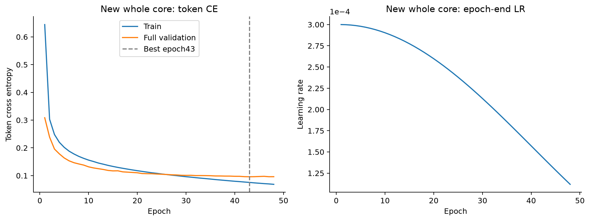
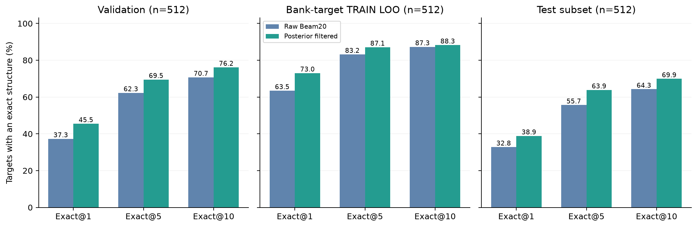

# 甘油＋头基新库：8,000 模板最终训练与生成结果

发布核验日期：2026-10-27（北京时间）。训练及预定三个生成队列均已正常完成。
训练在第 **48** 轮按patience5早停；最佳第 **43** 轮，完整验证 Token CE **0.0959413714**。

主库189,864：含P164,370，不含P25,494；TRAIN170,872 / validation9,493 / test9,499。
模板8,000来自TRAIN，含P6,244、不含P1,756；8,000个均保留为训练预测标签，每轮各一次。
每个目标排除自身和等价输入，跨划分等价图交集为0。模板目标留一式重建属于已训练标签诊断。
标签含固定甘油及两个脂肪酸角色端口101/102；分子式为H封端的中性甘油＋头基。
随机初始化，沿用E3方案；batch32 / K3 / AdamW / FP32 / Math / TF32off，最长标签94、上限96，无截断。
只按全部9,493个验证目标Token CE选最佳；测试不用于模型选择。

共 **256,320** 步，训练用时 **2.112 h**；48轮完整历史与最小值对应权重均核验通过。

每个生成队列512个目标、Beam20。测试这里只评价固定512子集，不是完整9,499测试目标。
原始Beam与后验分子式/端口/组装过滤分别报告；没有新增逐token元素/语法约束解码实验。
无效候选、缺EOS、无合格结果均保留在分母。

| 队列 | 输出 | Top-1 exact | Top-5 exact | Top-10 exact | Similarity@10 |
|---|---|---:|---:|---:|---:|
| 验证512 | 原始 | 37.30% | 62.30% | 70.70% | 0.8854 |
| 验证512 | 后验过滤 | 45.51% | 69.53% | 76.17% | 0.8821 |
| TRAIN模板目标512（留一式） | 原始 | 63.48% | 83.20% | 87.30% | 0.9448 |
| TRAIN模板目标512（留一式） | 后验过滤 | 73.05% | 87.11% | 88.28% | 0.9320 |
| 测试512 | 原始 | 32.81% | 55.66% | 64.26% | 0.8604 |
| 测试512 | 后验过滤 | 38.87% | 63.87% | 69.92% | 0.8466 |

| 队列 | 原始候选合法率 | 至少1个严格式正确候选 | 平均合法去重候选数 | 无合格候选 |
|---|---:|---:|---:|---:|
| 验证512 | 91.24% | 97.85% | 8.096 | 2.15% |
| TRAIN模板目标512（留一式） | 85.09% | 97.27% | 6.146 | 2.73% |
| 测试512 | 90.91% | 96.29% | 7.814 | 3.71% |

测试后验过滤的Similarity@10比最佳输入模板平均增加 **0.3937**；**91.80%** 的目标获得正收益。
官能团F1@10：原始 **0.9899**，过滤后 **0.9531**。
官能团按整个中性核心统计，包含固定甘油；Similarity指纹不以固定甘油原子为中心，邻域仍可含连接环境。
原始式正确候选中结构仍错误的比例为 **89.99%**；这是所有Beam候选的比例，不是目标Top-1错误率，说明仅有分子式正确不足以识别连接异构体。

| 测试类别 | 目标数 | 原始Top-10 exact | 后验过滤Top-10 exact | 后验过滤Similarity@10 |
|---|---:|---:|---:|---:|
| P | 444 | 64.19% | 70.50% | 0.8517 |
| nonP | 68 | 64.71% | 66.18% | 0.8133 |

nonP测试只有68个，分组指标应按该样本量解释。
结构预训练检索使用目标图，故这些是structure-oracle条件生成结果，不是独立真实MS/MS鉴定准确率。
原始与过滤候选次序不同，过滤可以提高exact，同时降低平均最大相似度；两种结果不可混用。
模板目标512是已训练标签的留一式参考重建，不能与未见测试512合并报成独立测试。

最佳权重：`step_229620_epoch_043.pt`；SHA256：`f8d7f646f6bfda7459296f5025adc78a9695b8b8bff4c34e8ae80c6d779e17c2`。权重及全部逐条候选只在G盘。
发布前从1,536个目标/30,720个原始候选流重放排名、去重及所有总体/P/nonP聚合；
合法候选的H封端分子式和exact图标记重新核对，全部与保存报告一致。
四个已完成GPU作业（训练＋三个评价）无观察到的显卡重置/新增GPU转储；WATCHDOG权限限制保留。
旧数据、旧停止锁与冻结源文件保持不变；本次发布未重新训练/解码。

[聚合JSON、全部48轮指标及发布核验](GLYCEROL_CORE_TEMPLATES8000_FINAL_20261027.json) · [两轮结果总览](TRAINING_ROUNDS_FINAL_20261027.md)
