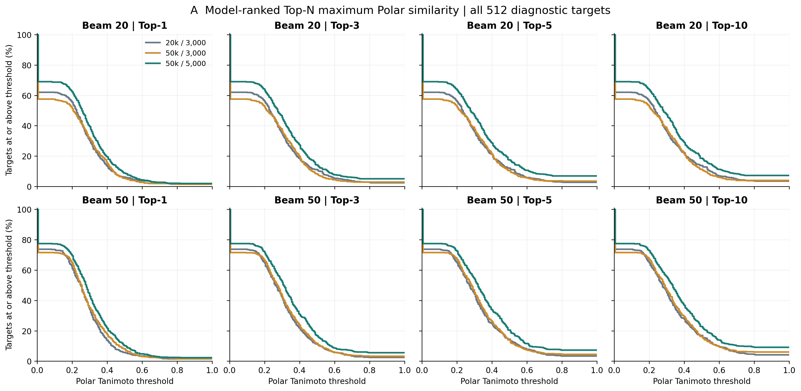
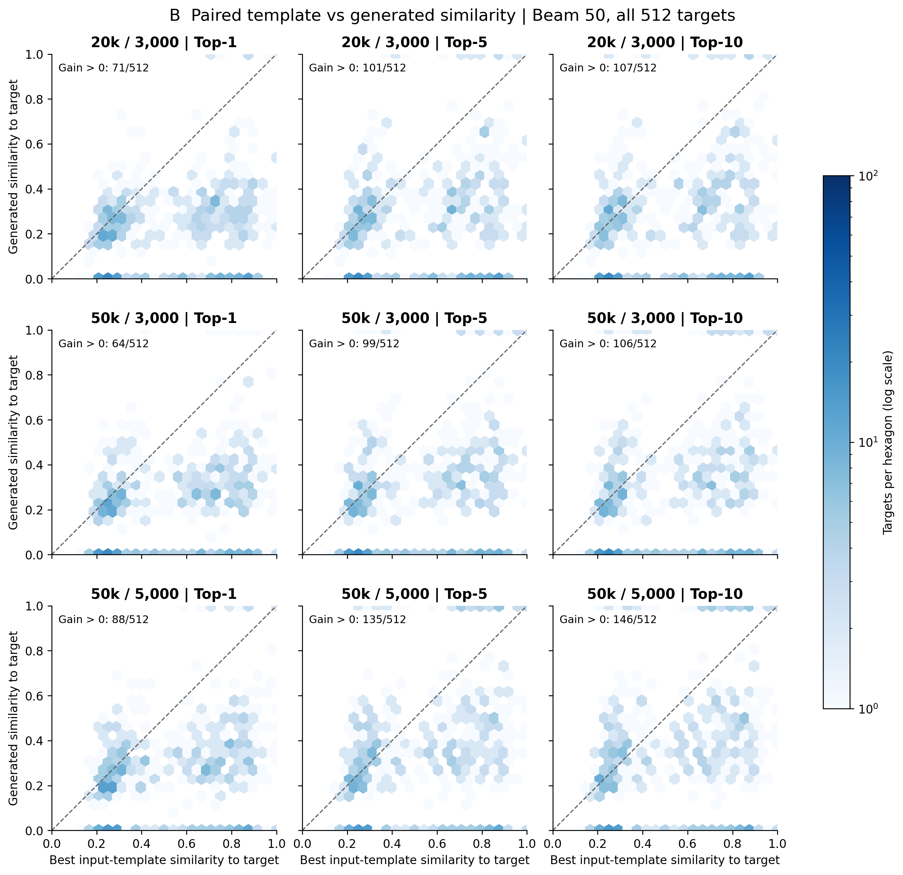
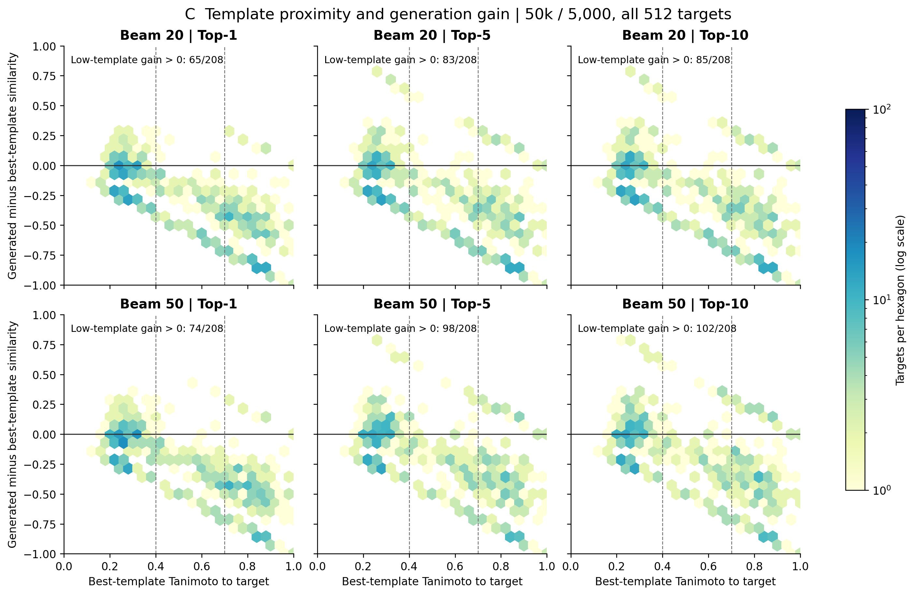

# v0.4-FP：结构相似度与参考模板收益评价

**结论：存在局部条件生成信号，但整体尚未稳定超过结构参考，暂不支持盲目扩大预训练。**
参考Top1平均相似度0.5410，最佳参考模板平均相似度0.5470；50k/5,000 Beam50的Top10最大相似度均值0.3499。Top10正收益为146/512 (28.52%)，平均Delta=-0.1971。

使用冻结且反复使用的512 validation诊断目标，structure-oracle检索、可信式和外部给定链；不是独立泛化测试或MS/MS鉴定评价。模型/标签/架构/连接规则未改，没有重新训练。
复用五组结果，仅补充50k/3,000 Beam50一次受监控推断。六组共3,072目标次，14,928个严格去重候选再次通过原Builder、连接、Polar含H式和完整中性式检查。
K=3是模板容量上限；沿用冻结检索结果，511个目标实际有3个模板，1个目标只有1个，其余位置按原流程mask。基线仅比较实际输入模板，不补检索、不复制补齐。

## Top-N相似度与覆盖

先按原模型分数截取严格候选Top-N，再计算与目标最大Tanimoto；不按目标重新排序。候选少于N用全部已有候选，无候选S_N=0。以下以全部512为分母。

|模型/Beam|覆盖|S1均值|S3均值|S5均值|S10均值|全部严格候选最大值均数|
|---|---|---:|---:|---:|---:|---:|
|20k_3000_b20|318/512 (62.11%)|0.2064|0.2274|0.2333|0.2405|0.2412|
|20k_3000_b50|378/512 (73.83%)|0.2342|0.2641|0.2781|0.2897|0.3029|
|50k_3000_b20|295/512 (57.62%)|0.1970|0.2164|0.2248|0.2285|0.2285|
|50k_3000_b50|367/512 (71.68%)|0.2404|0.2686|0.2825|0.2967|0.3036|
|50k_5000_b20|354/512 (69.14%)|0.2435|0.2783|0.2947|0.2984|0.2985|
|50k_5000_b50|397/512 (77.54%)|0.2736|0.3170|0.3347|0.3499|0.3562|

## 50k/5,000 Beam50累计阈值

|Top-N|>=0.5|>=0.6|>=0.7|>=0.8|>=0.9|=1.0|
|---|---|---|---|---|---|---|
|1|53/512 (10.35%)|25/512 (4.88%)|14/512 (2.73%)|13/512 (2.54%)|12/512 (2.34%)|12/512 (2.34%)|
|3|87/512 (16.99%)|45/512 (8.79%)|35/512 (6.84%)|29/512 (5.66%)|29/512 (5.66%)|29/512 (5.66%)|
|5|105/512 (20.51%)|60/512 (11.72%)|43/512 (8.40%)|38/512 (7.42%)|38/512 (7.42%)|38/512 (7.42%)|
|10|117/512 (22.85%)|72/512 (14.06%)|52/512 (10.16%)|47/512 (9.18%)|47/512 (9.18%)|47/512 (9.18%)|

Tanimoto=1与canonical图Exact分别计算；本配置的指纹相同不在定义上保证完整图相同。

|统计范围|Top-N|相似度均值|Delta均值|Delta中位数|正收益|零收益|负收益|
|---|---:|---:|---:|---:|---|---|---|
|all_targets|1|0.2736|-0.2734|-0.2595|88/512 (17.19%)|3/512 (0.59%)|421/512 (82.23%)|
|all_targets|5|0.3347|-0.2123|-0.2054|135/512 (26.37%)|5/512 (0.98%)|372/512 (72.66%)|
|all_targets|10|0.3499|-0.1971|-0.1928|146/512 (28.52%)|5/512 (0.98%)|361/512 (70.51%)|
|covered_targets|1|0.3529|-0.1985|-0.1887|88/397 (22.17%)|3/397 (0.76%)|306/397 (77.08%)|
|covered_targets|5|0.4316|-0.1197|-0.0807|135/397 (34.01%)|5/397 (1.26%)|257/397 (64.74%)|
|covered_targets|10|0.4512|-0.1001|-0.0671|146/397 (36.78%)|5/397 (1.26%)|246/397 (61.96%)|

全部六组的条件阈值、均值/中位数/分位数、Delta分布与配对重采样区间均在JSON。不将有候选目标的条件均值当成全512指标。

## 相对模板的收益与分层

template_best是在实际输入K个Polar中事后按目标取最大值，只是评价基线。模板允许不同式，生成候选严格匹配目标式；公式相同/不同与式L1差的分层也保存在JSON。
最佳模板仅48/512（9.38%）与目标Polar式相同，464/512不同式，不能直接作为严格候选使用。两组Top10平均Delta分别为−0.4498与−0.1709；这区分了化学组成正确与结构接近，不把负Delta简单解释成完全没有学习公式条件。

|模型/Beam|Top1正收益|Top5正收益|Top10正收益|Top10平均Delta|Top10 Delta中位数|
|---|---|---|---|---:|---:|
|20k_3000_b20|60/512 (11.72%)|82/512 (16.02%)|86/512 (16.80%)|-0.3065|-0.2745|
|20k_3000_b50|71/512 (13.87%)|101/512 (19.73%)|107/512 (20.90%)|-0.2572|-0.2476|
|50k_3000_b20|53/512 (10.35%)|68/512 (13.28%)|69/512 (13.48%)|-0.3184|-0.2851|
|50k_3000_b50|64/512 (12.50%)|99/512 (19.34%)|106/512 (20.70%)|-0.2502|-0.2500|
|50k_5000_b20|76/512 (14.84%)|112/512 (21.88%)|115/512 (22.46%)|-0.2486|-0.2509|
|50k_5000_b50|88/512 (17.19%)|135/512 (26.37%)|146/512 (28.52%)|-0.1971|-0.1928|

最终50k/5,000 Beam50分层；完整Top1/3/5/10及条件统计在JSON：

|分层|目标数|覆盖|S10均值|Delta10均值|正收益|Top10 Exact|
|---|---:|---|---:|---:|---|---|
|P_count:1|324|247/324 (76.23%)|0.3242|-0.2095|84/324 (25.93%)|27/324 (8.33%)|
|P_count:2|115|89/115 (77.39%)|0.3787|-0.1769|34/115 (29.57%)|14/115 (12.17%)|
|P_count:3|73|61/73 (83.56%)|0.4183|-0.1736|28/73 (38.36%)|6/73 (8.22%)|
|family:phosphate|212|159/212 (75.00%)|0.3147|-0.2128|51/212 (24.06%)|15/212 (7.08%)|
|family:phosphonate|162|119/162 (73.46%)|0.3007|-0.2355|39/162 (24.07%)|13/162 (8.02%)|
|family:polyphosphate|138|119/138 (86.23%)|0.4618|-0.1277|56/138 (40.58%)|19/138 (13.77%)|
|formula_TRAIN_frequency:0|87|47/87 (54.02%)|0.1957|-0.2995|14/87 (16.09%)|3/87 (3.45%)|
|formula_TRAIN_frequency:1_to_5|189|128/189 (67.72%)|0.2857|-0.2791|34/189 (17.99%)|12/189 (6.35%)|
|formula_TRAIN_frequency:6_to_50|196|184/196 (93.88%)|0.4462|-0.0995|80/196 (40.82%)|25/196 (12.76%)|
|formula_TRAIN_frequency:>50|40|38/40 (95.00%)|0.5165|-0.0645|18/40 (45.00%)|7/40 (17.50%)|
|length:16|112|112/112 (100.00%)|0.6099|+0.0725|70/112 (62.50%)|35/112 (31.25%)|
|length:32|138|123/138 (89.13%)|0.3713|-0.1807|37/138 (26.81%)|7/138 (5.07%)|
|length:48|140|107/140 (76.43%)|0.2811|-0.2666|21/140 (15.00%)|4/140 (2.86%)|
|length:64|120|55/120 (45.83%)|0.1687|-0.3860|18/120 (15.00%)|1/120 (0.83%)|
|length:80|2|0/2 (0.00%)|0.0000|-0.2133|0/2 (0.00%)|0/2 (0.00%)|
|template_best:high_>=0.7|192|151/192 (78.65%)|0.4195|-0.4089|25/192 (13.02%)|28/192 (14.58%)|
|template_best:low_<0.4|208|158/208 (75.96%)|0.2832|+0.0105|102/208 (49.04%)|9/208 (4.33%)|
|template_best:middle_0.4_to_0.7|112|88/112 (78.57%)|0.3544|-0.2194|19/112 (16.96%)|10/112 (8.93%)|

低模板组Top10平均Delta=+0.0105，中位数-0.0003，正收益102/208 (49.04%)；均值诊断bootstrap区间[-0.019445963947527598, 0.04110250749345083]跨0。因此不能声称低模板条件下已取得稳定平均收益。小样本分层只描述，不作显著性结论。
收益集中在短头基：16–31 token组Top10平均Delta=+0.0725，70/112（62.50%）正收益；64–79 token组为−0.3860，仅18/120（15.00%）正收益。多磷酸家族正收益56/138（40.58%），高于磷酸酯/膦酸酯组约24%，但三个家族平均Delta仍均为负。P=3组正收益28/73（38.36%），仍不足以说明多P条件普遍优于模板。TRAIN未见分子式组仅14/87（16.09%）正收益。这些是探索性描述差异，未作多重校正的独立显著性验证。

## 新颖性、核心保留与化学辅助指标

TRAIN已见指冻结TRAIN bank的图集合，并不表示每个图都曾作为该模型训练目标。TRAIN未见不等于天然产物新发现；下表新颖候选均为已严格筛选子集，其合法性不能反推原始输出100%合法。

|模型/Beam|严格候选数|模板复制|TRAIN未见|新颖候选目标T均值|新颖候选T>=0.7|
|---|---:|---|---|---:|---|
|20k_3000_b20|1388|3/1388 (0.22%)|1226/1388 (88.33%)|0.3345|25/1226 (2.04%)|
|20k_3000_b50|3541|4/3541 (0.11%)|3226/3541 (91.10%)|0.3251|47/3226 (1.46%)|
|50k_3000_b20|1198|4/1198 (0.33%)|1047/1198 (87.40%)|0.3409|29/1047 (2.77%)|
|50k_3000_b50|3137|5/3137 (0.16%)|2847/3137 (90.76%)|0.3315|46/2847 (1.62%)|
|50k_5000_b20|1634|3/1634 (0.18%)|1429/1634 (87.45%)|0.3528|51/1429 (3.57%)|
|50k_5000_b50|4030|9/4030 (0.22%)|3685/4030 (91.44%)|0.3409|73/3685 (1.98%)|

三方相似关系、候选相对模板/目标的完整分布、共同P核心保留及官能团等变化的计数见JSON。共同核心采用连接P二跳邻域一致的保守描述代理；不是反应路线或合成/生物真实性判据。P邻域、官能团/距离、末端、分支、环差异可重叠，未强制归为单一化学错误。
最终Beam50有2,215个候选机会对应参考与目标共同的连接P邻域；其中1,024（46.23%）保持该核心，992（44.79%）同时改变其他图特征，149（6.73%）还取得正相似度收益。这是候选级/共同核心机会分母，不能当作512个目标的成功比例。

|模型/Beam|Raw RDKit有效|Raw Polar有效|Polar式覆盖|完整中性式覆盖|联合严格覆盖|
|---|---|---|---|---|---|
|20k_3000_b20|3023/5819 (51.95%)|2980/5819 (51.21%)|318/512 (62.11%)|318/512 (62.11%)|318/512 (62.11%)|
|20k_3000_b50|7947/17165 (46.30%)|7841/17165 (45.68%)|378/512 (73.83%)|378/512 (73.83%)|378/512 (73.83%)|
|50k_3000_b20|2699/5011 (53.86%)|2647/5011 (52.82%)|295/512 (57.62%)|295/512 (57.62%)|295/512 (57.62%)|
|50k_3000_b50|7107/14349 (49.53%)|6984/14349 (48.67%)|367/512 (71.68%)|367/512 (71.68%)|367/512 (71.68%)|
|50k_5000_b20|3422/6437 (53.16%)|3395/6437 (52.74%)|354/512 (69.14%)|354/512 (69.14%)|354/512 (69.14%)|
|50k_5000_b50|8879/18134 (48.96%)|8812/18134 (48.59%)|397/512 (77.54%)|397/512 (77.54%)|397/512 (77.54%)|

Raw有效率以原始搜索候选为分母，沿原流程要求EOS；式覆盖以目标为分母。Raw中可能重复，严格候选canonical图去重；二者不混淆。完整中性式匹配候选率也在JSON单独记录。

|模型/Beam|Exact Top1|Exact Top5|Exact Top10|无候选|目标进Beam|目标进Beam但排10名后|合法异构体均数|
|---|---|---|---|---|---|---|---:|
|20k_3000_b20|8/512 (1.56%)|14/512 (2.73%)|18/512 (3.52%)|194/512 (37.89%)|18/512 (3.52%)|0/512 (0.00%)|2.711|
|20k_3000_b50|8/512 (1.56%)|18/512 (3.52%)|22/512 (4.30%)|134/512 (26.17%)|32/512 (6.25%)|10/512 (1.95%)|6.916|
|50k_3000_b20|8/512 (1.56%)|18/512 (3.52%)|21/512 (4.10%)|217/512 (42.38%)|21/512 (4.10%)|0/512 (0.00%)|2.340|
|50k_3000_b50|8/512 (1.56%)|23/512 (4.49%)|31/512 (6.05%)|145/512 (28.32%)|36/512 (7.03%)|5/512 (0.98%)|6.127|
|50k_5000_b20|10/512 (1.95%)|36/512 (7.03%)|37/512 (7.23%)|158/512 (30.86%)|37/512 (7.23%)|0/512 (0.00%)|3.191|
|50k_5000_b50|12/512 (2.34%)|38/512 (7.42%)|47/512 (9.18%)|115/512 (22.46%)|49/512 (9.57%)|2/512 (0.39%)|7.871|

## 图表

另有Beam20配对图；公开PNG/SVG/PDF均不含结构或目标标识。
Figure D已从真实预测制作7个事后案例，含改进、多P/长头基及失败。保留原排名，无候选处留空。结构图和真实式/相似度/差异标注仅在G盘 `outputs/polar_similarity_eval_v04_20261020/private_Figure_D/`，未上传GitHub。

## 判断与下一步

1. 50k/5,000相对两个3,000步模型的相似度分布改善，但20k/3,000与50k/5,000同时改变池和步数；同步数的池效应较弱且随Beam不同，不能将联合改善全部归因于头基覆盖。
2. 部分TRAIN未见且严格合法的生成图超过了最佳模板，说明有局部生成潜力；但大多数目标Delta为负，低模板组均值收益接近0且区间跨0，尚不能声称稳健条件结构变换。
3. 没有随机模板/无模板消融，正Delta也不能单独证明收益由模板信息因果驱动。模板结构使用、公式条件和Decoder先验的贡献仍需控制实验。
4. 暂不盲目扩大预训练池或堆叠网络。先评估模板利用的匹配随机模板/无模板对照，再开展有真实谱图、严格划分的小规模MS/MS条件实验及预训练vs随机初始化比较。若核心变换仍弱，再独立设计编辑模型对照，本轮未改架构。
5. checkpoint可作为后续初始化候选，但结构相似度、正确式与真实MS/MS鉴定是不同层次。本轮全为structure-oracle有利模板条件，未提供真实谱图鉴定性能证据。

## 后续控制方案：未执行

A：20k/3,000权重、AdamW、RNG字段和消费位置均通过CPU静态加载，具备进一步适配条件。旧训练入口仍有ROCm门槛，不能用拒绝旧契约的FP50k入口直接续训。未来应建独立native20k控制入口，保留旧3000及数据/配置契约，先完成受监控的真实反向/恢复门槛，再追加2000步至5000，不能宣称已验证可直接安全续训。
本机相同架构额外2000步实测约92–95秒（含阶段验证/保存；不含加载和新安全门槛）；Beam20约5分钟、Beam50约10–18分钟。以20–30分钟级窗口和1–2GiB新增输出预算规划，显存参考PyTorch峰值约535MiB、主进程RAM约2.4GiB，额外驱动/worker开销仍需监控。
B：真实MS/MS上固定相同划分、优化预算和检索流程，比较预训练与随机初始化；正常/随机模板均TRAIN-only且排除目标，随机对照尽量匹配链型/公式差值分布。无模板对照需未来明确定义合法占位/TCLS-only输入，不能把当前缺模板报错当实验。记录目标结构是否在预训练池中出现；不再用真实目标图帮助谱图阶段检索。
C：若上述消融证明模板利用不足，再单独设计保留连接P核心的编辑式生成对照。这些控制、额外训练与MS/MS微调本轮均未启动。

## 清理和复现

删除10,173个授权缓存/临时文件，逻辑大小1.234GiB；清理时磁盘空闲实测增加1.253GiB。所有checkpoint及评价源预测保留并复核哈希；三模型CPU重载通过。
详见 [磁盘审计](EXPERIMENT_STORAGE_AUDIT.md) 与本报告JSON。
372项测试通过；核心CUDA环境版本不变；补充推断无新可见GPU故障，WATCHDOG目录权限限制照实保留。
代码/输入/预测/图表哈希、配对比较和全部分层见JSON；最终commit SHA由交付回执提供。
