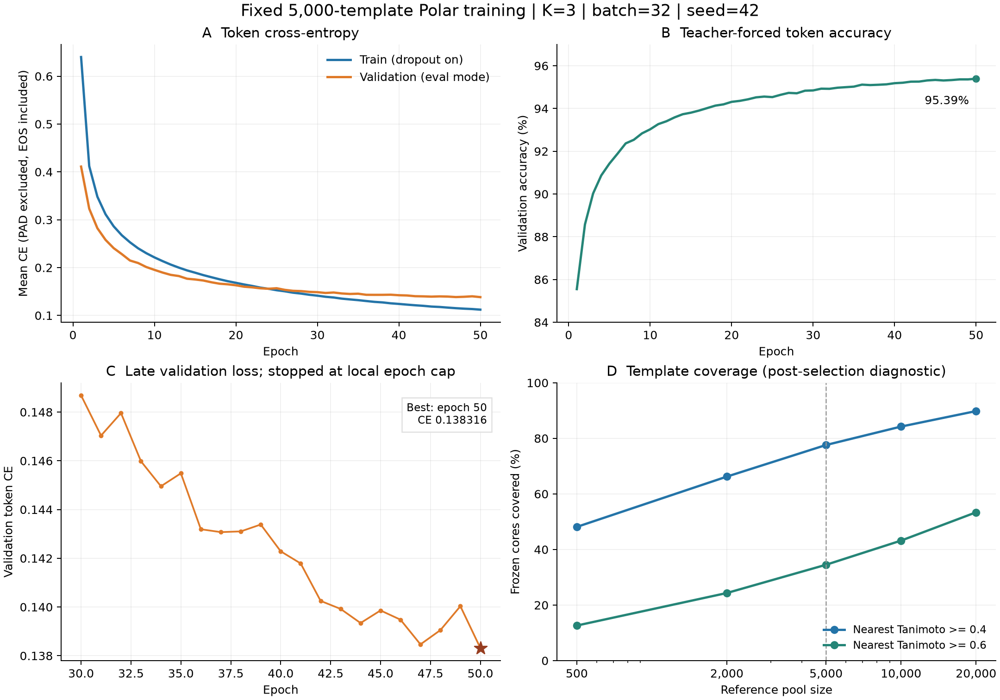
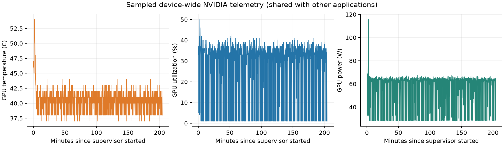

# 固定5,000模板引导 Polar 生成模型：训练结果报告

日期：2026-10-23。实验：fixed5000 / K3 / batch32 / seed42。本报告基于已完成的训练、完整验证与主机监控原始日志；本次整理仅使用CPU，不追加训练或启动生成实验。

## 结果与结论

主训练已于 **2026-10-23T04:05:17.264819+08:00（上海）** 正常结束，共 **50轮、267,950步**，训练耗时 **3.41小时**。
停止原因是预设的50 epoch上限；连续5轮验证loss无改善的早停条件没有触发。
逐轮复核得到，最长连续无新低为 **2轮**，未达到patience5。
按全部50轮完整验证集的最低token交叉熵选择，最佳为 **第50轮 / step267950**，验证CE **0.138316**。

从第1到第50轮，验证CE下降 **66.36%**；teacher-forced token准确率从 **85.5513%** 提升到 **95.3943%**。
后者计算真实前缀条件下下一token预测的正确比例，PAD排除、EOS计入。整条SMILES的Exact、结构化学有效率和分子式正确率需要自由生成后另行计算。
目前有证据支持“当前监督任务得到明显学习进展、训练和恢复流程稳定”；生成头基的科学可用性仍需要下文列出的生成评价支持。



## 数据和运行配置

|项目|实际设置|
|---|---|
|冻结原库|195,306个Polar graph，原文件与历史split保留|
|当前单连接派生范围|190,553个核心；共4,753个核心不进入本轮范围|
|训练/验证/测试|171,478 / 9,527 / 9,548个核心|
|每epoch样本|每个训练核心一次，每核心固定一个真实完整脂质代表行|
|完整验证|每轮9,527核心、429,014个有效token，共50轮|
|参考池|5,000图，其中118个人工审核兼容种子，其余为算法补选|
|参考入口|单/双链占位匹配的chainless Morgan FP；目标式由可信全式与已知链推导|
|自体与留出排除|排除目标自体/等价图；验证/测试图不进入训练参考池|
|输入参考数量|K3，检索缓存最多10，结构阈值0.2|
|模型|现有v0.4 FP结构，16,468,671参数；当前Tokenizer和带[*:1]标签保留|
|初始化|seed42随机初始化，未继承GPU测速/恢复probe权重|
|优化器|AdamW，lr1e-4，weight decay0.01，clip1，梯度累积1|
|精度/注意力|FP32 / Math SDPA / TF32关闭|
|执行设备|NVIDIA GeForce RTX 4070 SUPER，12,282 MiB|
|保存|每1,000步及每个完整epoch原子保存，best/last指针分开|

5,000输入模板全部通过Builder和独立含H元素平衡检查。此项描述输入模板检查；输出候选的Builder合格率仍待生成评价。
600Da和当前84-token标签上限用于本轮范围检查；审核库保留其原有来源和全部合法记录。
模板补选使用训练核心的近邻密度、MW/P/N/S/卤素分层和0.85 Tanimoto球排除，完整冻结库不被重写。
等价排除使用当前phosphate_comparison_key：去除立体标签、规范末端磷酸O的质子化，保留连接标记与重原子连接；这里没有进行全部互变异构体和所有质子化体系的全局归并。

选模依据沿用[MetGenX原文](https://doi.org/10.1038/s41467-026-72149-6)的验证loss原则和patience5规则；batch32对齐其主实验。
50轮是本地执行上限，网络、学习率、weight decay和检索阈值采用用户要求保留的现有项目配置。论文的结构数据、模型设置和任务范围与本实验不同，本文不进行跨论文loss或准确率排名。

## 训练过程与末期表现

|epoch|optimizer step|训练token CE|完整验证token CE|验证token准确率（真实前缀）|
|---:|---:|---:|---:|---:|
|1|5,359|0.640043|0.411114|85.5513%|
|2|10,718|0.412052|0.323105|88.5780%|
|5|26,795|0.286288|0.240689|91.4229%|
|10|53,590|0.221385|0.195304|93.0273%|
|20|107,180|0.168240|0.163119|94.3125%|
|30|160,770|0.141384|0.148685|94.8470%|
|40|214,360|0.124102|0.142285|95.1850%|
|47|251,873|0.115214|0.138465|95.3321%|
|48|257,232|0.114203|0.139051|95.3633%|
|49|262,591|0.113415|0.140033|95.3631%|
|50|267,950|0.112137|0.138316|95.3943%|

第40到50轮，验证CE从0.142285降至0.138316，相对下降 **2.79%**。
第47轮已达到0.138465，48/49轮有波动，第50轮再创最低值。末期改进幅度减小，但停止时没有满足patience5；达到轮数上限不能作为完成早停收敛的证据。
最终训练CE为0.112137，验证CE为0.138316，差值为0.026179。
训练CE是在dropout开启、epoch内权重不断更新时累计，验证CE是在epoch末eval模式计算，比较时应保留这一计算条件差异；该差值单独不足以判断过拟合。
目前只完成seed42一次运行，尚无多随机种子的方差或置信区间。
历史FP50k实验采用不同训练池、检索缓存和训练预算；本次尚未完成同目标、同候选预算的并列生成评价，因此不据两次loss直接判断新模型优于历史模型。

## 模板池覆盖诊断

下表在全195,306个冻结核心上计算，排除自身/等价参考，使用rooted Polar Morgan。它是选池后的离线结构诊断；训练特征入口使用chainless Morgan。
HNSW提供候选，随后精确位向量重排。主池单/双链输入检索各64个随机样本的精确top1分数命中为63/64；各池覆盖检索抽样记录见JSON。全量覆盖统计仍属于近似检索结果。

|模板数|最近模板Tanimoto均值|中位数|≥0.4覆盖|≥0.6覆盖|最近分子式L1距离中位数（含H）|
|---:|---:|---:|---:|---:|---:|
|500|0.424|0.391|48.13%|12.63%|3|
|2,000|0.492|0.460|66.23%|24.34%|2|
|5,000|0.541|0.515|77.60%|34.51%|2|
|10,000|0.579|0.562|84.23%|43.20%|1|
|20,000|0.620|0.615|89.81%|53.38%|1|

只有5,000池完成了本次生成模型训练。其他池在此仅有参考覆盖统计；不能据覆盖率推断其生成成绩，也不能据此判定5,000是最优池规模。
5,000池覆盖了全部16个预设SMARTS官能团/键类型标志。各标志允许重叠，数量分布并不均匀：

|结构标志|5,000模板中数量|
|---|---:|
|amine|2,105|
|quaternary_ammonium|42|
|alcohol_or_phenol|2,229|
|carboxyl_or_carboxylate|244|
|amide|526|
|ester|412|
|ether|2,949|
|nitrile|30|
|heterocycle|2,781|
|aromatic_heterocycle|2,360|
|carbonyl_other|1,167|
|sulfur|1,326|
|halogen|1,657|
|P_C_bond|1,381|
|P_S_bond|2|
|P_N_bond|1|

稀少的腈基、P–S、P–N等类型需要在后续生成评价中分层检查。“参考池出现过某类”与“模型能正确恢复该类”分别评价。

## 时间、资源与稳定性

|项目|实测结果|
|---|---:|
|训练进程总耗时（含验证/保存）|12267.4秒 / 3.41小时|
|监督器总耗时|12331.9秒|
|累计训练核心呈现次数|8,573,900|
|端到端有效吞吐（含验证/保存）|698.9核心/秒|
|batch16测速|643.9核心/秒|
|batch32测速|1080.3核心/秒，提升67.79%|
|训练峰值tensor allocated|850.4MiB|
|主训练checkpoint|317份，合计58.39GiB|
|NVIDIA采样|1214次|
|GPU温度|37–54°C，中位数41°C|
|GPU利用率采样|均值27.9%，中位数33%|
|显示驱动重置 / 新GPU dump|0 / 0|
|历史12份权重SHA|全部保持不变|
|监督器/训练退出|正常，退出码0|



NVIDIA遥测是设备总量，会包含其他桌面应用；tensor allocated来自PyTorch，二者统计口径不同。进程CPU/RAM峰值本轮未记录。
CPU与CUDA均完成真实反传和磁盘checkpoint保存/重载检查。CPU连续4步与2+2步结果精确一致；CUDA模型/优化器/logits/RNG通过预先声明的1e-5数值容差检查。
监控覆盖System4101、WER LiveKernelEvent141/117和可访问dump；受保护WATCHDOG目录不可读，该限制保留在主机报告中。
首次非r1测速的严格确定性开关错误及停止锁均保留；r1在用户明确授权后运行，本次完成后未追加训练。

## 最佳权重与复核文件

最佳/最近权重均为 `step_267950_epoch_050.pt`。重新计算SHA与best指针一致，并核对其loss为全部50轮完整验证的最低值。

```text
G:\yzx\linzhiyuce\phospholipid-structure-pretrain\outputs\template_guided_fp5000_20261022_r1\train_main_k3_seed42\checkpoint\step_267950_epoch_050.pt
SHA256: 96bfbdf2ef2ca79ced9105ac9728691d1272116f04a3474f149fabc3f945892d
```

同一私有运行目录保留training_report.json、validation_history.json、best.json、last.json、host_monitor.json、run_contract.json和events.jsonl。
独立完整统计见[同名JSON](TEMPLATE_GUIDED_FP5000_RESULTS_20261023.json)；[早期准备/启动记录](TEMPLATE_GUIDED_FP5000_START_20261022.md)继续保留。
权重、完整结构和逐目标数据保留在G盘，公开内容为代码、配置、聚合统计和图。

## 尚未完成的生成评价

|指标/实验|状态|
|---|---|
|Polar chemical validity|尚未评价|
|full neutral formula accuracy including H|尚未评价|
|Builder assembly success|尚未评价|
|candidate coverage and no-candidate rate|尚未评价|
|Polar exact Top1/5/10|尚未评价|
|Similarity@10|尚未评价|
|functional-group recovery|尚未评价|
|gain over best input template|尚未评价|
|formula-correct wrong-graph rate|尚未评价|
|legal isomer candidates per target|尚未评价|
|Restricted catalog ranking|尚未评价|
|pool/K/seed generation comparisons|尚未评价|

应固定本次按验证loss选出的第50轮权重，先以有界小批量验证生成、式约束和Builder通路，再运行固定验证诊断和独立结构测试。
原diagnostic512中有495个头基属于本轮单连接派生范围；后续须明确495/512的分母、17个范围外核心及代表链行差异，避免把范围变化当作成绩改进。
完整独立测试池为9,548核心。真实MS/MS检索和Restricted白名单排序仍属于后续应用阶段。
测试分数和化学指标用于评价已选模型；模型选择继续以完整验证loss为准。

## 附：全部50轮日志

|epoch|optimizer step|训练token CE|完整验证token CE|验证token准确率（真实前缀）|
|---:|---:|---:|---:|---:|
|1|5,359|0.640043|0.411114|85.5513%|
|2|10,718|0.412052|0.323105|88.5780%|
|3|16,077|0.348228|0.282386|90.0257%|
|4|21,436|0.311537|0.258001|90.8695%|
|5|26,795|0.286288|0.240689|91.4229%|
|6|32,154|0.267593|0.228198|91.8877%|
|7|37,513|0.252935|0.214831|92.3692%|
|8|42,872|0.240329|0.209624|92.5385%|
|9|48,231|0.230169|0.201229|92.8375%|
|10|53,590|0.221385|0.195304|93.0273%|
|11|58,949|0.213603|0.189676|93.2708%|
|12|64,308|0.206345|0.184858|93.4046%|
|13|69,667|0.199953|0.182381|93.5858%|
|14|75,026|0.194189|0.176784|93.7333%|
|15|80,385|0.189348|0.175189|93.8058%|
|16|85,744|0.184324|0.173053|93.9046%|
|17|91,103|0.179890|0.169356|94.0202%|
|18|96,462|0.175569|0.166378|94.1356%|
|19|101,821|0.171579|0.165121|94.1946%|
|20|107,180|0.168240|0.163119|94.3125%|
|21|112,539|0.164759|0.160113|94.3585%|
|22|117,898|0.161700|0.158741|94.4300%|
|23|123,257|0.158200|0.156765|94.5230%|
|24|128,616|0.155789|0.155824|94.5587%|
|25|133,975|0.152754|0.156916|94.5347%|
|26|139,334|0.150506|0.153517|94.6407%|
|27|144,693|0.147619|0.151504|94.7321%|
|28|150,052|0.145712|0.150909|94.7135%|
|29|155,411|0.143277|0.149347|94.8337%|
|30|160,770|0.141384|0.148685|94.8470%|
|31|166,129|0.139070|0.147035|94.9286%|
|32|171,488|0.137536|0.147959|94.9223%|
|33|176,847|0.135150|0.145980|94.9738%|
|34|182,206|0.133533|0.144955|94.9990%|
|35|187,565|0.132018|0.145486|95.0244%|
|36|192,924|0.130180|0.143191|95.1179%|
|37|198,283|0.128419|0.143073|95.0974%|
|38|203,642|0.127277|0.143102|95.1120%|
|39|209,001|0.125395|0.143385|95.1321%|
|40|214,360|0.124102|0.142285|95.1850%|
|41|219,719|0.122639|0.141787|95.2067%|
|42|225,078|0.121293|0.140249|95.2568%|
|43|230,437|0.120131|0.139921|95.2603%|
|44|235,796|0.118587|0.139342|95.3139%|
|45|241,155|0.117769|0.139858|95.3384%|
|46|246,514|0.116432|0.139479|95.3123%|
|47|251,873|0.115214|0.138465|95.3321%|
|48|257,232|0.114203|0.139051|95.3633%|
|49|262,591|0.113415|0.140033|95.3631%|
|50|267,950|0.112137|0.138316|95.3943%|
