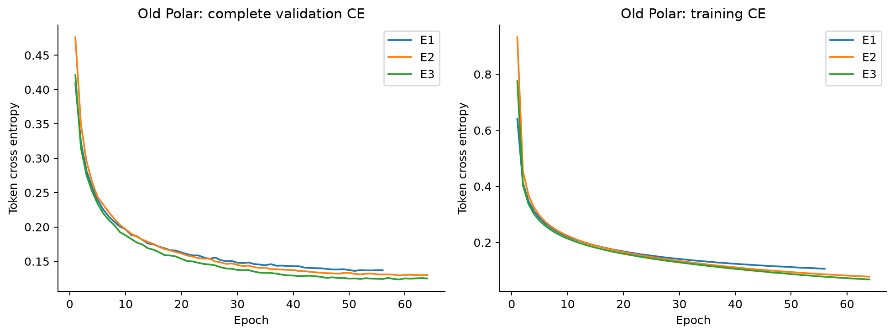

# 旧 Polar 模板引导训练：E1/E2/E3 最终结果

发布核验日期：2026-10-27（北京时间）。三组训练均已完成；旧生成评价异常中止，未补跑。

标签为含 P Polar 片段，带旧连接标记；有效目标190,553，TRAIN171,478 / validation9,527 / test9,548。
固定 TRAIN 模板5,000、K3、batch32；FP32 / Math Attention / TF32off。
E1 固定1e-4；E2 预热4,000步至1e-4后余弦至1e-5；E3 预热至3e-4后余弦至1e-5。
三组只按完整验证 Token CE 最小值选模，patience5，不用测试集选择。

| 实验 | 完成轮数 | 总步数 | 最佳轮数 | 最佳验证 Token CE | 本次完成段用时 |
|---|---:|---:|---:|---:|---:|
| E1 | 56 | 300,104 | 51 | 0.1361242244 | 2.842 h |
| E2 | 64 | 342,976 | 59 | 0.1294714501 | 3.371 h |
| E3 | 64 | 342,976 | 59 | 0.1236898564 | 2.472 h |

E3 在这三组相同数据/标签实验中验证 CE 最低。E2 从旧中断点恢复；表中用时是完成运行段，非整个跨日期总耗时。
全部56/64/64轮训练与完整验证曲线已核对，最佳轮数、步数、CE与实际权重 SHA256 一致。

生成评价于2026-10-26中止：RDKit `KekulizeException` 来自候选结构处理，监督器退出 child_failed。
原 state.json 的 running 是历史残留；本报告依据训练报告、监督器及停止锁判定。
保留原停止锁、部分原始输出及故障记录。未将不完整前缀当作完整验证/测试结果；生成指标在 JSON 中为 null。
因此本轮不能给出可靠的最终分子生成 Top-k / 分子式覆盖 / Similarity@10。

| 实验 | 最佳权重文件（仅保存在G盘） | SHA256 |
|---|---|---|
| E1 | step_273309_epoch_051.pt | ebf5b365b2dfce6717a14df2333c5214558362b5509d58050f7f3a6ead71646c |
| E2 | step_316181_epoch_059.pt | 3931e7f1398d4fd9bc6d1fa21bcc093dc08d639ffcaff910b37d813d92b2812f |
| E3 | step_316181_epoch_059.pt | e98fb5cfd8919b77402dcfa8a5dc686ce60a367c6228e9163786b63ee0ce1671 |

这些完成运行段的监控未观察到显卡重置或新增 GPU 转储；WATCHDOG 目录仍无读取权限。
旧73项冻结源代码哈希及停止锁保持不变。本次仅CPU核验与发布，不训练、不恢复故障评价。

[完整聚合JSON与逐轮指标](TEMPLATE_GUIDED_V2_FINAL_20261027.json) · [两轮结果总览](TRAINING_ROUNDS_FINAL_20261027.md)
