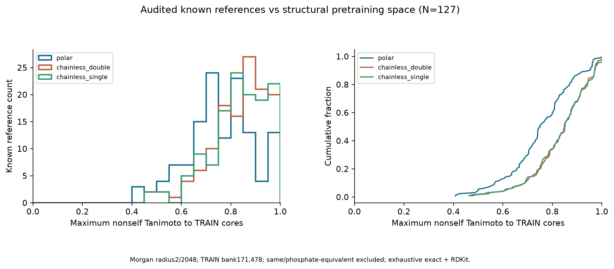
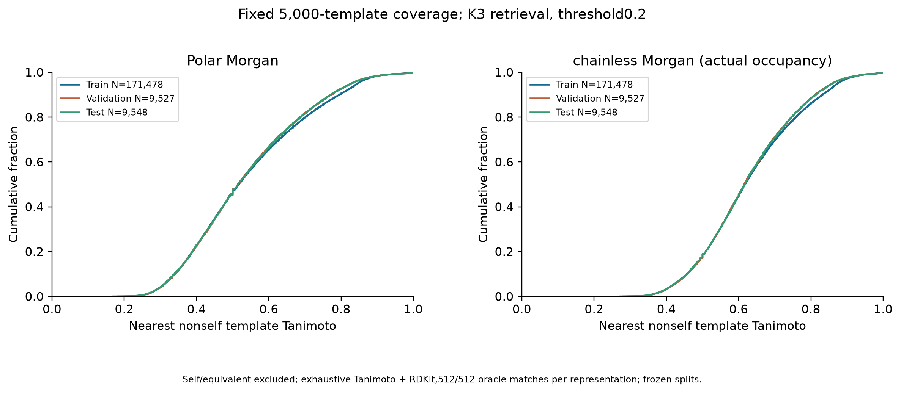
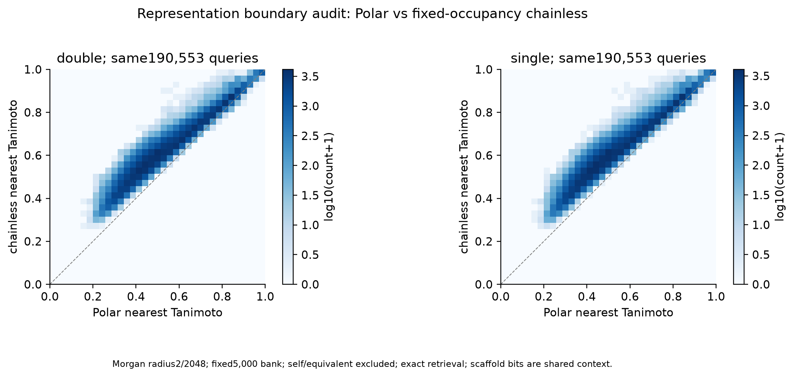

# 模板引导正式 V2.0：审计与执行状态（2026-10-23）

当前状态：`preflight`。本文件是实际状态快照；
未完成的训练和生成指标在JSON中为null，不把预备审计当作正式模型结果。

用户V2.0计划已落地，旧50轮实验归为探索性实验，其全部文件保留。
新正式实验独立随机初始化，不继承旧模型。全部数据和输出留G盘。

原冻结195,306核心保持不变；有效190,553，训练171,478、验证9,527、测试9,548。
跨划分身份/磷酸等价交集均为0；2,015,000条完整脂质记录与核心划分一致。
195,306个目标分子式恒等式（含H）、5,000个模板Builder/H、10,000个模板chainless
指纹逐一检查通过；118个人工审核种子来源可追溯。

Polar片段与chainless输入分别计算，后者包含甘油与101/102链位点，
共享骨架会提高相似度，不能混用其绝对分数。三种查询均对同一5,000模板池
执行精确检索并排除自身/等价项，独立512/512的Top3身份及分数全部吻合RDKit。

|chainless占据数|两表示Top1身份一致|Top3交集/3均值|最近分数Spearman|对旧HNSW的Top1身份变化数|
|---|---:|---:|---:|---:|
|double|80.47%|80.23%|0.9702|5,881|
|single|79.49%|79.47%|0.9705|5,794|

最后一列是身份差异数，含并列身份处理的影响，**不是HNSW严格错误率**。
新V2缓存统一采用精确结果；原缓存、标签和5,000模板身份保留。
所有190,553目标在0.2阈值下均有3个合法参考，不静默丢弃难样本。

127个已审核且兼容的参考头基对TRAIN的非自身最大Polar相似度均值
0.7553、中位数0.7500，
四分位数0.6781/0.8462。
这不是MS/MS微调集。全部名称、SMILES、来源与邻居的逐条清单留私有目录。

|查询集|指纹|核心数|均值|中位数|≥0.4|≥0.6|
|---|---|---:|---:|---:|---:|---:|
|train|Polar|171,478|0.5430|0.5167|77.85%|34.84%|
|train|chainless_actual_occupancy|171,478|0.6315|0.6180|96.89%|55.54%|
|validation|Polar|9,527|0.5377|0.5143|77.87%|33.66%|
|validation|chainless_actual_occupancy|9,527|0.6270|0.6154|96.86%|55.34%|
|test|Polar|9,548|0.5377|0.5147|77.76%|33.81%|
|test|chainless_actual_occupancy|9,548|0.6268|0.6170|96.82%|55.47%|

逐化学家族、16项官能团、单双链和碳数区间的覆盖统计见聚合JSON。
三张图均提供PNG/SVG/PDF，PDF经Poppler渲染并逐张目视检查。

原测试9,548中，4,694个与TRAIN最近邻Polar相似度≥0.8。新增4,815个目标的
诊断子集，保留于4,778个稀疏图诊断簇。每个测试目标均另行对全部TRAIN精确排查。
HNSW top32稀疏图的簇属于近似分量，不能当作穷举完整簇划分；此子集仅作额外
近训练排除诊断，不替代原测试，不参与学习率选择。

PE/PG/PS、复杂N、S、多P的12项单双链Builder与含H往返通过；
多P连接依据标记邻接P，不取第一个P。随机模型实际BOS-only解码166次调用通过，
该探针不代表训练质量。72项相关测试通过。
CPU真实恢复门槛：True；CUDA真实恢复门槛：False。

|实验|学习率|上限|状态|
|---|---|---|---|
|E1|固定1e-4，无scheduler|80epoch/428720更新|未完成|
|E2|4000步warmup→1e-4，cosine→1e-5|相同|未完成|
|E3|4000步warmup→3e-4，cosine→1e-5|相同|未完成|

只用完整验证Token CE选择权重及学习率，patience5；测试不用于优化。
300验证试评、完整验证及完整测试按普通/元素语法约束Beam20分别报告原始和过滤结果。
完整核心Similarity使用chainless，Polar与可变头基另报；每项Template Gain
均在同一种指纹内比较。所有失败与空候选目标保留在分母，指标不提前填数。
Formula-only和额外随机种子须在模板阶段结果稳定性评估后实施，本初始队列未启动。

新输出采用**最佳＋最近两份**完整断点，去重后最多3份/组，约0.6GiB/组；
原子保存、哈希及CPU重载通过后才清理本组已登记过时文件。原探索性主训练
317份权重约58.39GiB全部保留。共享不可变数组；每目标原始候选gzip、指标Parquet、
流式汇总，无logits/attention/全配对矩阵。当前新增独占输出约0.165GiB；
新V2软预算8GiB、硬预算12GiB，超限停止，不触碰历史目录。

私有根目录：`outputs/template_guided_v2_20261023`。所有GPU工作使用独立监督器；
故障锁禁止自动重试。WATCHDOG目录读取不可用，其他Windows事件、可读dump和NVIDIA遥测保留。

执行约定见[正式V2.0](../experiments/TEMPLATE_GUIDED_FORMAL_V2.md)。
更新本状态快照：`python scripts/report_template_guided_v2.py`，该命令不启动训练。
